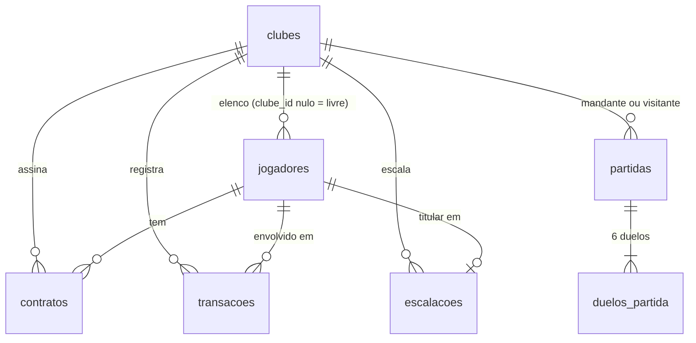

# ⚽ FootMarket API

API REST do **mercado de jogadores de uma liga de futebol fictícia**, feita para o desafio técnico de
*Desenvolvedor Fullstack Júnior* do Instituto Senai de Inovação.

Os clubes têm jogadores com contrato, escalam 5 titulares (1 goleiro e 4 jogadores de linha) e jogam partidas.
O placar sai dos atributos dos titulares, **sem sorteio**: com os mesmos titulares nas mesmas condições, o resultado
é sempre o mesmo. Cada partida grava os 6 duelos que a decidiram, e a classificação é calculada a cada consulta.

> Este repositório contém o **backend**. Veja em [Status do desafio](#-status-do-desafio) o que já está pronto
> e o que ainda falta.

---

## 📑 Sumário

1. [Status do desafio](#-status-do-desafio)
2. [Como rodar o projeto](#-como-rodar-o-projeto)
3. [Estrutura do projeto](#-estrutura-do-projeto)
4. [Tecnologias utilizadas](#-tecnologias-utilizadas)
5. [Endpoints](#-endpoints)
6. [Regras de negócio implementadas](#-regras-de-negócio-implementadas)
7. [Modelo de dados](#-modelo-de-dados)
8. [Tratamento de erros](#-tratamento-de-erros)
9. [Decisões técnicas](#-decisões-técnicas)
10. [Testes](#-testes)
11. [Teste rápido da liga (passo a passo)](#-teste-rápido-da-liga-passo-a-passo)
12. [Limitações conhecidas e próximos passos](#-limitações-conhecidas-e-próximos-passos)

---

## ✅ Status do desafio

O enunciado tem quatro módulos. Esta é a situação de cada um:

| Módulo | Funcionalidade | Situação |
| --- | --- | --- |
| **Jogadores** | Cadastro, consulta, edição (PUT) e exclusão lógica | ✅ Pronto |
| | Valor base calculado pela API (overall + potencial) | ✅ Hoje o `valorBase` é informado no cadastro |
| | Valor de mercado e overall calculados na consulta | ✅ Pronto |
| | Alteração de condição física (`PATCH /players/{id}/condition`) | ✅ Pronto |
| | Listagem paginada, com busca, filtros e ordenação | ✅ Hoje devolve a lista completa |
| **Clubes** | Cadastro, listagem, consulta, edição e exclusão | ✅ Pronto |
| | Elenco com contrato, valor do elenco e patrimônio | ✅ Pronto |
| | Ordenação da listagem por patrimônio | ✅ Pronto |
| **Mercado** | Contratos de fidelidade (criar, consultar, alterar, excluir) | ✅ Parcial (endpoint próprio) |
| | Compra com taxa e limite de 50% do caixa | ✅ Pronto |
| | Venda com multa por fidelidade e comissão sobre o lucro | ✅ Pronto |
| | Registro e listagem simples de transações | ✅ `POST` e `GET /transactions` |
| | Histórico por clube com totais (`summary`), filtros e exportação em CSV | ✅ Pronto |
| **Liga** | Escalação dos 5 titulares com formação | ✅ Pronto |
| | Partidas com placar calculado pelos atributos e 6 duelos | ✅ Pronto |
| | Histórico de partidas e consulta de uma partida | ✅ Pronto |
| | Classificação | ✅ Pronto |
| **Geral** | Docker (`Dockerfile` e `docker-compose`) | ✅ Pronto |
| | Tratamento de erros com `{"message": ...}` | ✅ Pronto |
| | Testes automatizados | ✅ Pronto (veja [Testes](#-testes)) |

---

## 🚀 Como rodar o projeto

### Pré-requisitos

- **Java 21** (para rodar direto na máquina)
- **MySQL 8** (para rodar direto na máquina)
- **Docker e Docker Compose** (para rodar com contêineres, que dispensa Java e MySQL locais)

### Opção 1: Docker (recomendada)

Sobe o MySQL e a API juntos:

```bash
docker compose up --build
```

- A API fica em `http://localhost:8080`.
- O MySQL fica em `localhost:3306` (banco `footmarket`, usuário `root`, senha `root`).
- As tabelas são criadas sozinhas pelo Flyway na primeira subida.
- Os dados ficam no volume `mysql_data`. Para apagar tudo e começar do zero: `docker compose down -v`.

### Opção 2: direto na máquina

1. Suba um MySQL 8 em `localhost:3306` com usuário `root` e **senha vazia** (padrão do `application.properties`).
   O banco `footmarket` é criado automaticamente (`createDatabaseIfNotExist=true`).
2. Na pasta `backend`, rode:

```bash
./mvnw spring-boot:run        # Linux/macOS
mvnw.cmd spring-boot:run      # Windows
```

A API sobe em `http://localhost:8080`. Os caminhos têm o prefixo `/api/v1` (exemplo:
`GET http://localhost:8080/api/v1/clubs`).

### Configuração

Os valores padrão ficam em `src/main/resources/application.properties`. Para trocar qualquer um deles sem editar o
arquivo, use variáveis de ambiente (o Spring Boot converte o nome da propriedade para maiúsculas com `_`):

| Variável | Para que serve | Padrão local |
| --- | --- | --- |
| `SPRING_DATASOURCE_URL` | URL JDBC do MySQL | `jdbc:mysql://localhost:3306/footmarket?...` |
| `SPRING_DATASOURCE_USERNAME` | Usuário do banco | `root` |
| `SPRING_DATASOURCE_PASSWORD` | Senha do banco | vazia |
| `SPRING_FLYWAY_ENABLED` | Liga ou desliga as migrations | `true` |
| `SERVER_PORT` | Porta da API | `8080` |

No `docker-compose.yml`, a API já recebe `SPRING_DATASOURCE_URL`, `SPRING_DATASOURCE_USERNAME` e
`SPRING_DATASOURCE_PASSWORD` apontando para o contêiner `db`.

### Rodar os testes

```bash
./mvnw test
```

O teste `BackEndApplicationTests` carrega o contexto inteiro e **precisa do MySQL rodando**.
Os demais testes usam mocks e rodam sem banco.

---

## 🗂️ Estrutura do projeto

```
backend/
├── Dockerfile                  # build em duas etapas (Maven + JRE 21)
├── docker-compose.yml          # MySQL 8 + API
├── pom.xml
├── mvnw / mvnw.cmd             # Maven Wrapper
└── src/
    ├── main/
    │   ├── java/br/com/gustavo/footmarket/back_end/
    │   │   ├── BackEndApplication.java
    │   │   ├── config/         # WebConfig: CORS
    │   │   ├── controller/     # Camada HTTP: rotas, @Valid, status de sucesso
    │   │   ├── dto/
    │   │   │   ├── request/    # Corpos de entrada com Bean Validation
    │   │   │   └── response/   # Corpos de saída (records)
    │   │   ├── entity/         # Entidades JPA (uma por tabela)
    │   │   ├── embeddable/     # Chave composta da escalação
    │   │   ├── exception/      # GlobalExceptionHandler: erros em JSON
    │   │   ├── repository/     # Spring Data JPA (consultas derivadas e JPQL)
    │   │   ├── service/        # Regras de negócio e transações
    │   │   └── utils/          # OrdemElenco: ordem GOL, ZAG, MEI, ATA
    │   └── resources/
    │       ├── application.properties
    │       └── db/migration/V1__criar_tabelas.sql   # esquema (Flyway)
    └── test/java/...           # testes de serviço e de controller
```

**Fluxo de uma requisição:** `controller` (valida o corpo e chama o serviço) → `service` (aplica as regras dentro de
uma transação) → `repository` (acessa o MySQL). Os serviços devolvem `records` de `dto/response`, e as entidades
nunca saem pela API.

---

## 🧰 Tecnologias utilizadas

| Tecnologia | Versão | Por que está no projeto |
| --- | --- | --- |
| **Java** | 21 | Linguagem. Usa `records` nos DTOs de entrada e saída. |
| **Spring Boot** | 3.5.6 | O enunciado pede Spring Boot 3. Traz o servidor web, a injeção de dependências e a configuração. |
| `spring-boot-starter-web` | | API REST (Spring MVC com Jackson). |
| `spring-boot-starter-validation` | | Bean Validation (`@NotNull`, `@Pattern`, `@Positive`...) nos DTOs de entrada, com mensagens claras. |
| `spring-boot-starter-data-jpa` | | JPA/Hibernate: repositórios sem SQL escrito à mão e controle de transações com `@Transactional`. |
| **MySQL** + `mysql-connector-j` | 8.0 | Banco relacional com persistência em disco. |
| **Flyway** (`flyway-core` e `flyway-mysql`) | | Versiona o esquema em SQL (`V1__criar_tabelas.sql`). O `flyway-mysql` é obrigatório nas versões atuais; sem ele o Flyway falha com *Unsupported Database: MySQL*. O Hibernate **não** altera o esquema (`ddl-auto=none`). |
| `spring-boot-starter-test` | | JUnit 5, Mockito e MockMvc. |
| **Maven Wrapper** | | Qualquer pessoa roda o projeto sem instalar o Maven. |
| **Docker** / **Docker Compose** | | Ambiente reproduzível: API e banco sobem com um comando. |

Não há Lombok: getters e setters das entidades estão escritos no código.

---

## 🌐 Endpoints

Base: `http://localhost:8080/api/v1`. Corpos e respostas em JSON.

### Clubes

| Método e rota | Descrição | Sucesso | Erros |
| --- | --- | --- | --- |
| `POST /clubs` | Cria clube | 201 | 400, 409 |
| `GET /clubs` | Lista clubes | 200 | |
| `GET /clubs/{id}` | Consulta um clube | 200 | 404 |
| `PUT /clubs/{id}` | Atualiza nome, sigla, caixa e formação | 200 | 400, 404, 409 |
| `DELETE /clubs/{id}` | Exclui o clube | 204 | 404, 409 |

### Jogadores

| Método e rota | Descrição | Sucesso | Erros |
| --- | --- | --- | --- |
| `POST /players` | Cadastra jogador | 201 | 400 |
| `GET /players` | Lista jogadores ativos | 200 | |
| `GET /players/{id}` | Consulta um jogador | 200 | 404 |
| `PUT /players/{id}` | Atualiza o jogador | 200 | 400, 404 |
| `DELETE /players/{id}` | Exclusão lógica | 204 | 404 |

### Contratos

| Método e rota | Descrição | Sucesso | Erros |
| --- | --- | --- | --- |
| `POST /contracts` | Cria contrato ATIVO | 201 | 400, 404, 409 |
| `GET /contracts` | Lista contratos | 200 | |
| `GET /contracts/{id}` | Consulta um contrato | 200 | 404 |
| `GET /contracts/player/{jogadorId}/active` | Contrato ativo do jogador | 200 | 404 |
| `PUT /contracts/{id}` | Altera valor e fim da fidelidade | 200 | 400, 404, 409 |
| `DELETE /contracts/{id}` | Apaga contrato ATIVO | 204 | 404, 409 |

### Transações

| Método e rota | Descrição | Sucesso | Erros |
| --- | --- | --- | --- |
| `POST /transactions` | Registra uma COMPRA ou VENDA no histórico, com os valores informados | 201 | 400, 404 |
| `GET /transactions` | Lista as transações, da mais recente para a mais antiga. Filtro opcional `?clubeId=` | 200 | 404 |
| `GET /transactions/{id}` | Consulta uma transação | 200 | 404 |

### Escalação

| Método e rota | Descrição | Sucesso | Erros |
| --- | --- | --- | --- |
| `PUT /clubs/{clubeId}/lineup` | Define a formação e os 5 titulares (substitui a anterior) | 200 | 400, 404, 409 |
| `GET /clubs/{clubeId}/lineup` | Escalação atual | 200 | 404 |

### Liga

| Método e rota | Descrição | Sucesso | Erros |
| --- | --- | --- | --- |
| `POST /matches` | Joga uma partida entre dois clubes | 201 (com `Location`) | 400, 404, 409 |
| `GET /matches` | Lista as partidas, da mais recente para a mais antiga. Filtro opcional `?club_id=` | 200 | 400, 404 |
| `GET /matches/{id}` | Partida com os 6 duelos | 200 | 404 |
| `GET /standings` | Classificação de todos os clubes | 200 | |

> Os campos de **partidas e classificação** estão em inglês e `snake_case`, como pede o enunciado. Os demais
> recursos usam os nomes em português do projeto (`nome`, `sigla`, `valorBase`, `clubeId`...).

---

## 📏 Regras de negócio implementadas

### Clubes
- O **nome** é único depois de remover espaços repetidos, **sem diferenciar maiúsculas de minúsculas**
  (a comparação usa a versão em maiúsculas, guardada em `nome_normalizado`). Nome repetido devolve **409**.
- A **sigla** tem exatamente 3 letras e é gravada em maiúsculas. Ela é única por constraint do banco
  (`uq_clubes_sigla`); uma sigla repetida devolve **409**.
- O **caixa** não pode ser negativo e aceita até 2 casas decimais.
- A **formação** é um texto de até 5 caracteres. Ela é atualizada quando o clube escala (veja abaixo).

### Jogadores
- Posições aceitas no cadastro: `GOL`, `ZAG`, `MEI` e `ATA`.
- Limites: agilidade, os 6 atributos e o potencial de 0 a 100; idade de 1 a 100; `valorBase` maior que zero.
- Condição: `APTO`, `MAL_CONDICIONADO` ou `DOENTE`.
- O `clubeId` é opcional; se for informado, o clube precisa existir (senão **400**).
- A **exclusão é lógica**: o jogador recebe `excluido_em`, some das consultas e continua no banco.

### Contratos
- Só é criado para jogador (não excluído) e clube existentes (**404** caso contrário).
- Um jogador só pode ter **um contrato ATIVO** por vez (**409**).
- O fim da fidelidade precisa ser **depois de agora** e **no máximo 1.095 dias** à frente (**400**).
- Só um contrato ATIVO pode ser alterado ou apagado; jogador e clube do contrato não mudam (**409**).
  Contratos ENCERRADO e RESCINDIDO ficam como histórico e nunca são apagados.

### Escalação
- Formações aceitas, contando os 4 jogadores de linha (o goleiro fica fora da conta):

| Formação | Defesa (ZAG/LAT) | Meio (MEI) | Ataque (ATA) |
| --- | --- | --- | --- |
| `3-1` | 3 | 0 | 1 |
| `2-2` | 2 | 0 | 2 |
| `2-1-1` | 2 | 1 | 1 |
| `1-2-1` | 1 | 2 | 1 |

- `PUT` recebe `formacao` e exatamente 5 ids, em qualquer ordem, e **substitui a escalação inteira** numa única
  transação.
- Ordem das recusas: **400** (formato, 5 ids, ids repetidos) → **404** (clube ou jogador inexistente) → **409**
  (jogador fora do elenco do clube, jogador `DOENTE`, ou posições que não fecham a formação).
  Quando recusa, nada é gravado.
- A resposta traz `completa` (`true` com 5 titulares) e os titulares na **ordem do elenco**: posição
  (GOL, ZAG, MEI, ATA), depois nome (sem acento e sem diferenciar maiúsculas) e depois id.

### Partidas (`POST /matches`)
Cada partida segue estes passos, numa única transação:

1. **Conferências:** mandante e visitante diferentes (**400**); os dois clubes existem (**404**); os dois têm
   escalação completa, com os 5 titulares (**409**).
2. **Titulares:** em cada time, na ordem do elenco: o goleiro e depois os 4 jogadores de linha, numerados do 1º
   (o mais recuado) ao 4º (o mais avançado).
3. **Condição:** titular `MAL_CONDICIONADO` joga com **15% a menos** em cada atributo
   (`atributo × 0,85`, arredondado para o inteiro mais próximo, com o meio para cima: 74 → 63; 50 → 43).
   O efeito vale só na partida; os atributos do jogador não mudam.
4. **Duelos:** são sempre 6. Nos duelos 1 a 3 o mandante ataca; nos 4 a 6, o visitante.

| Duelo do mandante | Duelo do visitante | Atacante | Defensor (do adversário) |
| --- | --- | --- | --- |
| 1 | 4 | 4º jogador de linha | Goleiro |
| 2 | 5 | 3º jogador de linha | 1º jogador de linha |
| 3 | 6 | 2º jogador de linha | 2º jogador de linha |

5. **Valores:** o atacante usa o atributo da posição (`ATA`: finalização; `MEI`: passe; `ZAG`/`LAT`: drible) e o
   defensor usa sempre a defesa.
6. **Gol:** sai quando o ataque é **maior** que a defesa (empate não é gol). Cada clube marca de 0 a 3 gols.
   O campo `result` é `MANDANTE`, `VISITANTE` ou `EMPATE`.
7. **Gravação:** a partida guarda o horário, o placar, as formações e os 6 duelos com **nomes, posições,
   condições e valores do momento**. Editar um jogador depois não altera partidas já jogadas.
8. A partida **não muda** o caixa, a escalação nem os jogadores, e pode ser repetida a qualquer momento.

### Classificação (`GET /standings`)
- Lista **todos os clubes**, inclusive os que ainda não jogaram (zerados).
- Vitória vale 3 pontos, empate 1 e derrota 0.
- Ordem: **pontos** → **saldo de gols** → **gols marcados** → **nome do clube** (sem acento, sem diferenciar
  maiúsculas) → id. O campo `position` vai de 1 ao total de clubes, sem repetir.
- É calculada a cada consulta a partir das partidas gravadas; nada é salvo.

### Transações
- `POST /transactions` grava o registro de uma COMPRA ou VENDA com o **nome do jogador do momento**.
- A variação do caixa é calculada no registro: compra = `-(valor + taxa)`; venda = `valor - multa - comissão`.
  Na venda, o `lucro` é obrigatório e pode ser negativo; na compra, multa e lucro são ignorados.
- Este endpoint **só registra** o histórico: ele não altera o caixa do clube nem o elenco.
- `GET /transactions` ordena da mais recente para a mais antiga (empate: id decrescente).

---

## 🗄️ Modelo de dados

O esquema é criado pelo Flyway em `db/migration/V1__criar_tabelas.sql`, com 7 tabelas:



| Tabela | Conteúdo |
| --- | --- |
| `clubes` | Nome, `nome_normalizado` (único), sigla (única), caixa (padrão 300,00) e formação |
| `jogadores` | Dados e atributos do jogador, `valor_base`, condição, `clube_id` (nulo = livre) e `excluido_em` |
| `contratos` | Jogador, clube, `valor_compra`, `fidelidade_ate` e situação (ATIVO, ENCERRADO, RESCINDIDO) |
| `transacoes` | Compras e vendas, com nome do jogador, valores e variação do caixa gravados no momento |
| `escalacoes` | Titulares de cada clube (chave composta `clube_id` + `jogador_id`; o jogador é único) |
| `partidas` | Mandante, visitante, placar, formações e horário |
| `duelos_partida` | Os 6 duelos de cada partida, com os valores usados |

Valores em moeda usam `DECIMAL` (sem perda de precisão) com 2 casas.

---

## 🚦 Tratamento de erros

Toda recusa devolve um **objeto JSON com o campo `message`**, sem stack trace, e nada é gravado:

```json
{ "message": "O clube mandante e o visitante devem ser diferentes." }
```

O tratamento fica centralizado em `GlobalExceptionHandler`:

| Situação | Status |
| --- | --- |
| Falha de validação do corpo (`@Valid`), JSON malformado, corpo que não é objeto, tipo errado (ex.: texto onde se espera número), query param inválido | **400** |
| Recurso inexistente; caminho inexistente; id inválido na URL (`abc`, `0`, `01`) | **404** |
| Regra de negócio violada (nome duplicado, escalação incompleta, contrato ativo existente...) e violação de constraint do banco | **409** |
| Método HTTP não previsto em um caminho que existe | **405** |
| Falha inesperada (registrada no log, com mensagem genérica) | **500** |

---

## 🧭 Decisões técnicas

O enunciado deixa alguns detalhes em aberto. Estas foram as escolhas feitas:

- **Horário de Brasília (-03:00):** contratos, transações, escalações e partidas gravam a data com o relógio de
  `America/Sao_Paulo`. As respostas de partidas trazem `played_at` no formato `AAAA-MM-DDTHH:MM:SS-03:00`.
- **Moeda:** `BigDecimal` no Java e `DECIMAL` no banco, nunca `double`.
- **Nome do clube:** a unicidade vale após remover espaços repetidos e ignorando maiúsculas, **mas considerando
  acentos** (`Águias FC` e `Aguias FC` são clubes diferentes). A regra é garantida também pela constraint do banco.
- **Ordem alfabética:** nomes são comparados em minúsculas e sem acentos. Empates são desfeitos pelo id.
- **Valores calculados não são gravados:** classificação, `completa` na escalação e demais totais são calculados a
  cada consulta.
- **Partidas congeladas:** os duelos guardam nome, posição, condição e valor do momento (não há recálculo), para o
  histórico não mudar quando um jogador for editado ou trocado de clube.
- **Sem sorteio:** o placar depende só dos atributos, então o resultado é reproduzível e testável.
- **Esquema só pelo Flyway:** `spring.jpa.hibernate.ddl-auto=none`. O banco é alterado apenas por migrations versionadas.
- **`open-in-view` desligado:** as consultas lazy acontecem dentro das transações dos serviços, e não na camada web.
- **Tipos estritos no JSON:** `spring.jackson.mapper.allow-coercion-of-scalars=false` impede que `"15"` (texto) seja
  aceito como número.
- **Exclusão lógica de jogadores** (`excluido_em`), para que contratos, transações e partidas antigas continuem
  consistentes.
- **Operações atômicas:** escalar e jogar partida rodam em uma única transação (`@Transactional`): ou grava tudo,
  ou nada.
- **CORS:** liberado apenas para as origens `http://localhost:5173` e `http://localhost:3000` (frontend em
  desenvolvimento), nunca `*`. Veja `WebConfig`.

---

## 🧪 Testes

| Teste | O que cobre |
| --- | --- |
| `ContratoServiceTest` (Mockito) | Criação de contrato válido e recusa quando o jogador já tem contrato ativo |
| `PartidasControllerTest` (`@WebMvcTest` + MockMvc) | `POST /matches` devolve 201; 400 para clubes iguais, com `message`; 404 para partida inexistente |
| `BackEndApplicationTests` | Sobe o contexto do Spring (precisa do MySQL rodando) |

Rodar: `./mvnw test`.

---

## 🧪 Teste rápido da liga (passo a passo)

Com a API no ar, este roteiro cria dois clubes completos e joga uma partida. Use Postman, Insomnia ou `curl`.

**1. Criar os clubes** (`POST /api/v1/clubs`). Informe sempre o `caixa`:

```json
{ "nome": "Sport", "sigla": "SPO", "caixa": 8300.00 }
```

Repita para o segundo clube (ex.: `Santa Cruz`, `STA`). Anote os `id` devolvidos.

**2. Criar 5 jogadores para cada clube** (`POST /api/v1/players`). Para a formação `2-1-1`, cada clube precisa de
1 `GOL`, 2 `ZAG`, 1 `MEI` e 1 `ATA`:

```json
{
  "nome": "Otto Rangel",
  "posicao": "ATA",
  "agilidade": 75,
  "idade": 23,
  "valorBase": 120.00,
  "condicao": "APTO",
  "clubeId": 1,
  "velocidade": 78,
  "finalizacao": 75,
  "passe": 73,
  "drible": 82,
  "defesa": 48,
  "fisico": 68,
  "potencial": 88
}
```

**3. Escalar cada clube** (`PUT /api/v1/clubs/{id}/lineup`):

```json
{ "formacao": "2-1-1", "jogadorIds": [5, 3, 1, 4, 2] }
```

**4. Jogar a partida** (`POST /api/v1/matches`):

```json
{ "home_club_id": 1, "away_club_id": 2 }
```

Resposta `201 Created`, com `Location: /api/v1/matches/{id}` (duelos abreviados):

```json
{
  "id": 1,
  "played_at": "2026-11-12T15:00:00-03:00",
  "home": { "club_id": 1, "club_name": "Sport", "formation": "2-1-1", "goals": 1 },
  "away": { "club_id": 2, "club_name": "Santa Cruz", "formation": "2-1-1", "goals": 2 },
  "result": "VISITANTE",
  "duels": [
    {
      "order": 1,
      "attacking_club_id": 1,
      "attacker": { "player_id": 5, "player_name": "Otto Rangel", "position": "ATA",
                    "condition": "APTO", "attribute": "shooting", "value": 75 },
      "defender": { "player_id": 9, "player_name": "Ivo Teles", "position": "GOL",
                    "condition": "APTO", "attribute": "defending", "value": 72 },
      "goal": true
    }
  ]
}
```

**5. Consultar:**

- `GET /api/v1/matches/1` devolve a partida com os 6 duelos.
- `GET /api/v1/matches?club_id=1` lista as partidas do clube, sem os duelos.
- `GET /api/v1/standings` devolve a classificação.

**Erros esperados:** mandante igual ao visitante → `400`; clube inexistente → `404`; clube sem escalação completa →
`409`; `GET /api/v1/matches/abc` → `404`.

---

## ⚠️ Limitações conhecidas e próximos passos

**Funcionalidades do enunciado que ainda faltam**
- Compra e venda de jogadores (`POST /players/{id}/buy` e `/sell`), com taxa de 5%, limite de 50% do caixa, multa
  por fidelidade e comissão progressiva sobre o lucro. Com elas, o caixa e o elenco passam a mudar de verdade.
- Valor base, valor de mercado e overall calculados pela API, e o `PATCH /players/{id}/condition`.
- Listagem de jogadores paginada, com busca, filtros e ordenação (`data` e `meta`).
- Elenco, valor do elenco e patrimônio na consulta do clube, e ordenação de clubes por patrimônio.
- Histórico de transações do clube com `summary` e a exportação em CSV.
- Remover o titular da escalação quando ele for vendido ou ficar `DOENTE` (o método `removerTitular` existe,
  mas só será chamado quando esses fluxos existirem).
- Frontend em React.
- Cobertura maior de testes (hoje só há 5 testes de unidade e de controller, mais o carregamento do contexto).

**Pontos a corrigir no código atual**
- Se o `caixa` for omitido na criação do clube, a API devolve **500** (o valor padrão está escrito como
  `"300,00"` com vírgula). Informe sempre o `caixa` até a correção.
- Se a `condicao` for omitida no cadastro do jogador, a API devolve **500**. Informe sempre a condição.
- A posição `LAT` ainda não é aceita no cadastro de jogador, e a `OrdemElenco` também não a conhece.
- Os arquivos `dev.properties` e `local.properties` **não são carregados** pelo Spring (o nome precisaria ser
  `application-dev.properties`), e o `local.properties` aponta para H2, que não está nas dependências.
- O `Dockerfile` declara `EXPOSE 8000`, mas a API escuta na porta **8080** (que é a mapeada no `docker-compose`).
- O `POST /transactions` não tem `@Valid` no controller, então as validações do `TransacaoRequest` não rodam
  (campo faltando vira **500**). O `GET /transactions/{id}` também falha, porque o `TransacaoRepository` usa
  `Long` como tipo do id e a entidade usa `Integer`.
- O CORS não libera o método `PATCH` (será preciso incluí-lo quando o `PATCH /players/{id}/condition` existir).
- A exclusão lógica do jogador grava `excluido_em` com o relógio do sistema, e não o de Brasília.
- Não existe `.env.example`; a configuração local está no `application.properties` e a do Docker, no
  `docker-compose.yml`.